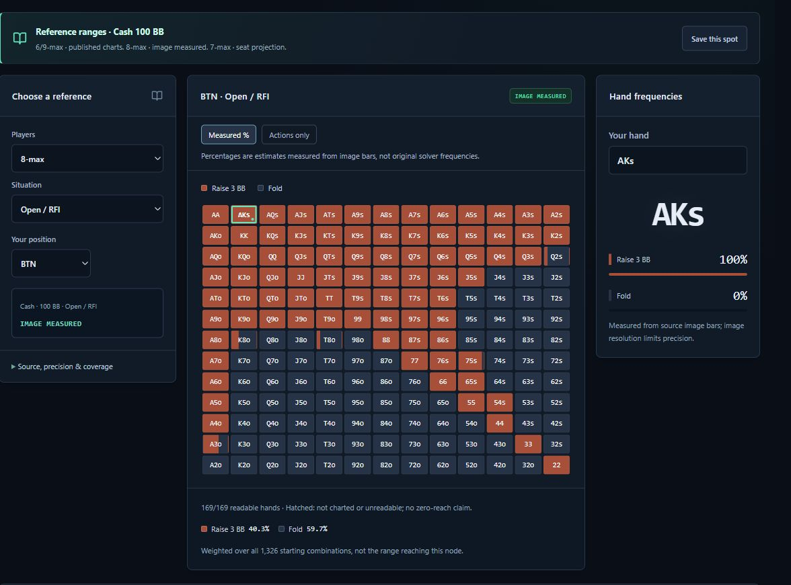

<p align="center">
  
</p>

<h1 align="center">GTO Reminder</h1>

<p align="center"><strong>Ruoyu Hold’em Strategy Lab</strong></p>

<p align="center">
  Study preflop decisions for <strong>6–9 player, 100 BB Texas Hold’em cash games</strong>.<br>
  Browse ranges, reconstruct action histories, and see the chart or model behind each frequency.
</p>

<p align="center">
  <a href="https://gto.tianyizhou.cn/"><strong>Try the live app →</strong></a>
  &nbsp;·&nbsp; <a href="README.md">中文</a> &nbsp;·&nbsp; English
</p>

<p align="center">
  <a href="https://github.com/Ruoyu-Tianyi/GTO_Reminder/actions/workflows/ci.yml"></a>
</p>

[](https://gto.tianyizhou.cn/)

*Live example: 8-max · 100 BB · BTN open. The percentages are measured from the reference image’s bars.*

## Start in 30 seconds

1. [Open the workspace](https://gto.tianyizhou.cn/). No account or manual data import required.
2. Under **Reference ranges**, choose `8-max → Open / RFI → BTN`. The matrix shows 169 starting-hand classes. Select `AKs` to see its actions and frequencies.
3. Expand **Source, precision & coverage** to inspect the evidence. For 8-max image transcriptions, switch to **Actions only** to read the charted actions without percentages.

## What you can study

| Question | Where to look |
| --- | --- |
| Which hands open from this position? | **Reference ranges** shows a 13 × 13 matrix with source charts and page numbers. |
| What does the model do after this exact sequence? | **Action history** lets you enter each action and inspect the matching model’s bet sizes, frequencies, and reach weights. |
| Can I look up a spot if I already know its settings? | **Quick lookup** matches player count, position, stack, and sizing. It also accepts your own strategy JSON. |
| Where can I compare sources, save a spot, or estimate equity? | **Data coverage** lists sources and gaps, **Saved spots** bookmarks queries, and **local analysis** estimates showdown equity and conditional call EV in eligible heads-up all-in spots. |

## Coverage and precision

**434 standard scenario categories · 325 reference scenarios · 11 computational models · 29,425 action-history decisions.** Standard scenarios include opening, facing an Open / 3-Bet / 4-Bet / 5-Bet, and two blind-limp spots. Each category has at least one source with complete hand rows under the [project’s coverage criteria](docs/ACCEPTANCE.md).

- **Reference charts:** The 325 scenarios include 234 chart transcriptions and 91 seat projections from 8-max to 7-max. Measured 8-max bars have about ±2 percentage points of uncertainty; the 7-max projections were not solved again. The 6/9-max Facing 3-Bet view shows earlier sizes when they can be verified in the same source; unreported sizes stay unknown.
- **Computed models:** Restricted approximations and unconverged results are labeled. Strategies stay tied to their stack depth, rake, sizing, and action history. A missing hand is never treated as a fold.
- **Scope:** These coverage counts do not represent a complete Hold’em GTO solution. The library focuses on 100 BB preflop play; postflop, ICM, and arbitrary bet sizing are outside the current scope. See the [data sources](docs/DATA_SOURCES.md) and [verification notes](docs/VERIFICATION.md).

## Run locally

**Node.js 22.12+** is recommended. Preview the app with the public snapshot included in the repository; there’s no need to download private solver files.

```bash
git clone https://github.com/Ruoyu-Tianyi/GTO_Reminder.git
cd GTO_Reminder
npm ci
npm run build
npm run preview
```

Open the local address printed in the terminal. Use `npm run dev` when editing code and `npm test` to run the checks. Windows developers can also use [`start.ps1`](start.ps1).

## Public strategy library and local data

The app serves the public library as static files and loads strategy data and source PDFs on demand. Manually imported strategy JSON stays in the current page session. Import ranges you have permission to use in [v1 quick-node](docs/DATA_FORMAT.md) or [v2 action-history](docs/DATA_FORMAT_V2.md) format.

## Work across devices

Open the same site on another device to use the built-in library. Bookmarks stay in the current browser; move them with [export and import](docs/STUDY_TOOLS.md). Private source files used for development can be copied separately using the [migration guide](docs/DATA_MIGRATION.md).

## Docs and feedback

The detailed guides are in Chinese; code examples and schema identifiers are shared across both languages.

- **Verify a chart:** [Source chart index](docs/PUBLIC_CHARTS.md) · [8-max transcription method](docs/POKERCOACHING_TRANSCRIPTION.md)
- **Reproduce or publish:** [Local solver](docs/LOCAL_SOLVER.md) · [Snapshot updates and deployment](docs/DEPLOYMENT.md#日常发布与数据更新)
- **Help improve the project:** [Roadmap](docs/ROADMAP.md) · [Report an issue](https://github.com/Ruoyu-Tianyi/GTO_Reminder/issues). For a range issue, include the player count, position, action sequence, and source label so it can be reproduced.
