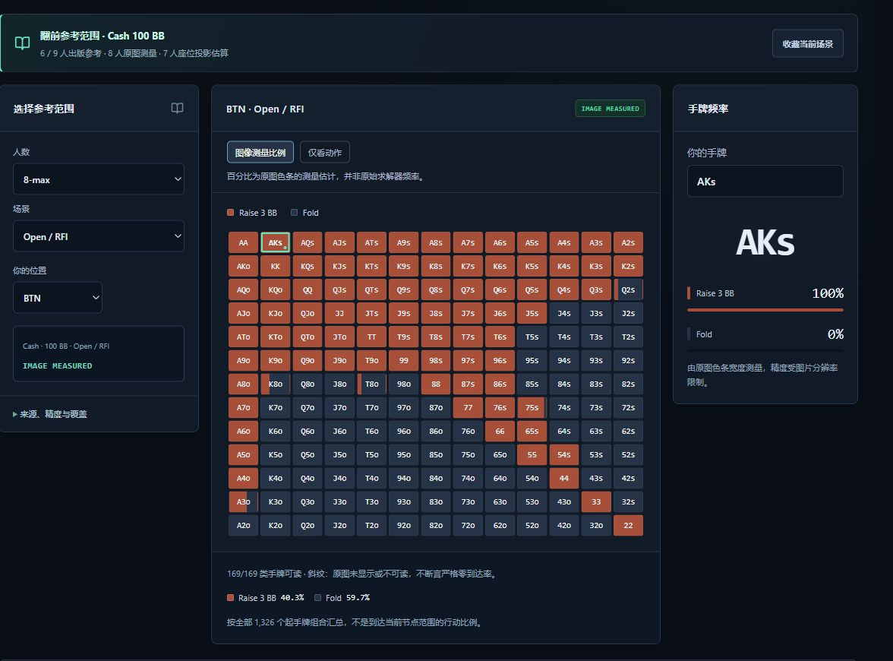

<p align="center">
  
</p>

<h1 align="center">GTO Reminder</h1>

<p align="center"><strong>若瑜德州策略研究</strong></p>

<p align="center">
  在 <strong>6–9 人、100 BB 德州扑克现金桌</strong>中，查起手牌范围、还原翻前行动，<br>
  并看清每个频率来自哪张图、哪个模型。
</p>

<p align="center">
  <a href="https://gto.tianyizhou.cn/"><strong>在线体验 →</strong></a>
  &nbsp;·&nbsp; 中文 &nbsp;·&nbsp; <a href="README.en.md">English</a>
</p>

<p align="center">
  <a href="https://github.com/Ruoyu-Tianyi/GTO_Reminder/actions/workflows/ci.yml"></a>
</p>

[](https://gto.tianyizhou.cn/)

*实机示例：8 人桌 · 100 BB · BTN 开池。图中百分比由参考原图的色条测量得到。*

## 30 秒开始

1. [打开工作台](https://gto.tianyizhou.cn/)，无需注册或手动导入策略。
2. 在 **参考范围图** 选择 `8-max → Open / RFI → BTN`。矩阵展示 169 类起手牌；点击 `AKs` 查看该手牌的动作和频率。
3. 展开 **来源、精度与覆盖** 核对数据。8 人原图转录可切换 **仅看动作**，只看图中记录的打法。

## 可以做什么

| 想研究的问题 | 从哪里开始 |
| --- | --- |
| 这个位置用哪些牌开池？ | **参考范围图**：在 13 × 13 矩阵查看范围，追溯到原图和页码。 |
| 按实际下注顺序走到这里，该怎么打？ | **完整行动历史**：逐步记录行动，查看匹配模型的下注尺寸、频率和到达权重。 |
| 已经知道位置和下注条件，能直接查吗？ | **快捷范围查询**：按人数、位置、筹码和尺寸匹配节点，也可导入自有 JSON。 |
| 想比较不同来源、收藏或估算胜率？ | **数据覆盖**可查来源及缺口；**我的收藏**可保存场景；**本机计算**可模拟摊牌胜率，并在适用的单挑全压场景估算条件跟注 EV。 |

## 数据范围与精度

**434 类标准场景 · 325 个参考场景 · 11 个计算模型 · 29,425 个行动历史决策。** 标准场景包括开池、面对 Open / 3-Bet / 4-Bet / 5-Bet，以及两种盲位 Limp 场景。每类至少有一个来源提供完整手牌行；覆盖按[项目验收口径](docs/ACCEPTANCE.md)统计。

- **参考图**：325 个参考场景包含 234 个出版图表转录和 91 个 8→7 人座位投影。8 人图的测量比例约有 ±2 个百分点误差，7 人投影未重新求解。6 / 9 人面对 3-Bet 时会展示能从同源图表核对的前序尺寸，未标明的尺寸保持未知。
- **计算模型**：受限近似与未收敛结果均有标记。不同筹码、抽水、下注尺寸或行动历史的策略分别查询；缺失手牌不会被记为弃牌。
- **研究边界**：场景覆盖数不等于完整德州扑克 GTO 解。当前聚焦 100 BB 翻前，翻后、ICM 和任意下注尺寸不在本轮范围内。详见[数据来源](docs/DATA_SOURCES.md)与[验证记录](docs/VERIFICATION.md)。

## 本地运行

推荐 **Node.js 22.12+**。克隆后可直接用仓库内的公开快照预览线上功能，无需下载本机求解文件。

```bash
git clone https://github.com/Ruoyu-Tianyi/GTO_Reminder.git
cd GTO_Reminder
npm ci
npm run build
npm run preview
```

打开终端给出的本机地址。修改代码时使用 `npm run dev`；运行检查使用 `npm test`。Windows 开发也可使用 [`start.ps1`](start.ps1)。

## 公开策略库与本地数据

公开策略库随网页静态发布，范围数据和原始 PDF 按需加载。手动导入的策略 JSON 留在当前页面会话。导入自己的数据时，请使用有权使用的范围文件，并按 [v1 快捷节点](docs/DATA_FORMAT.md)或 [v2 行动历史](docs/DATA_FORMAT_V2.md)格式准备。

## 多设备协作

换设备可以直接访问同一个网站查内置策略。个人收藏保存在浏览器，通过[导出和导入](docs/STUDY_TOOLS.md)迁移；开发用的私有源数据可按[数据迁移指南](docs/DATA_MIGRATION.md)单独复制。

## 文档与反馈

- **核对图表**：[原始图表索引](docs/PUBLIC_CHARTS.md) · [8 人图转录方法](docs/POKERCOACHING_TRANSCRIPTION.md)
- **复现或发布**：[本机求解](docs/LOCAL_SOLVER.md) · [更新公开快照与部署](docs/DEPLOYMENT.md#日常发布与数据更新)
- **参与改进**：[路线图](docs/ROADMAP.md) · [反馈问题](https://github.com/Ruoyu-Tianyi/GTO_Reminder/issues)。反馈范围图时，请附上人数、位置、行动历史和来源标签，方便复现。
